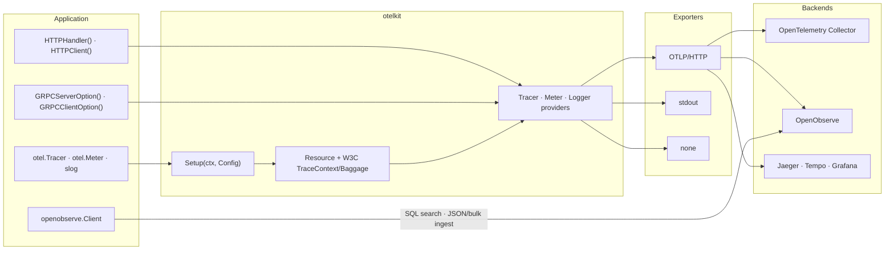

<div align="center">

# otelkit

**A small, pluggable OpenTelemetry bootstrap kit for Go.**

Wire traces, metrics, logs, propagation and HTTP/gRPC instrumentation with one
call — then use the standard `otel` and `slog` APIs everywhere else.

[](https://github.com/semmidev/otelkit/actions/workflows/ci.yml)
[](https://pkg.go.dev/github.com/semmidev/otelkit)
[](go.mod)
[](https://goreportcard.com/report/github.com/semmidev/otelkit)
[](LICENSE)

[Architecture](#architecture) · [Features](#features) · [Installation](#installation) · [Quick Start](#quick-start) · [Configuration](#configuration) · [Example](example/README.md)

</div>

---

## Table of Contents

- [Architecture](#architecture)
- [Features](#features)
- [Installation](#installation)
- [Quick Start](#quick-start)
- [Configuration](#configuration)
  - [Config fields](#config-fields)
  - [Telemetry methods](#telemetry-methods)
- [Exporters](#exporters)
- [Logging](#logging)
- [HTTP Instrumentation](#http-instrumentation)
- [gRPC Instrumentation](#grpc-instrumentation)
- [OpenObserve Client](#openobserve-client)
- [Example](#example)
- [Development](#development)
- [Compatibility](#compatibility)
- [Contributing](#contributing)
- [License](#license)

## Architecture



`Setup` installs the providers once. From then on the application talks to the
standard `otel` and `slog` APIs, while the HTTP and gRPC helpers add spans,
metrics and propagation around each call. The `openobserve` package bypasses
OTLP for the OpenObserve-only SQL and ingestion APIs.

## Features

- **One-call setup** — installs tracer, meter and logger providers, resource
  attributes and W3C TraceContext/Baggage propagation.
- **Pluggable exporters** — OTLP/HTTP, stdout or no-op; works with an
  OpenTelemetry Collector, OpenObserve, Jaeger, Tempo or any OTLP backend.
- **`slog` bridge** — logs automatically carry `trace_id` and `span_id`.
- **HTTP and gRPC helpers** — server spans, client spans, metrics and context
  propagation without touching handlers.
- **OpenObserve client** — SQL search and JSON/bulk ingestion for the APIs that
  OTLP does not cover.
- **No wrapper APIs** — application code keeps using `otel.Tracer`,
  `otel.Meter` and `slog` directly.

## Installation

```bash
go get github.com/semmidev/otelkit
```

Requires Go 1.27 or newer.

## Quick Start

```go
package main

import (
	"context"
	"log/slog"
	"net/http"
	"os/signal"
	"syscall"
	"time"

	"github.com/semmidev/otelkit"
	"go.opentelemetry.io/otel"
)

func main() {
	ctx, stop := signal.NotifyContext(context.Background(), syscall.SIGINT, syscall.SIGTERM)
	defer stop()

	telemetry, err := otelkit.Setup(ctx, otelkit.Config{
		ServiceName:    "checkout",
		ServiceVersion: "1.0.0",
		Environment:    "production",
		Exporter:       otelkit.ExporterOTLP,
		Endpoint:       "http://otel-collector:4318", // optional
	})
	if err != nil {
		slog.Error("init telemetry", "error", err)
		return
	}
	defer telemetry.Shutdown(context.Background())

	mux := http.NewServeMux()
	mux.HandleFunc("GET /healthz", func(w http.ResponseWriter, r *http.Request) {
		slog.InfoContext(r.Context(), "health check")
		w.WriteHeader(http.StatusOK)
	})

	srv := &http.Server{
		Addr:              ":8080",
		Handler:           otelkit.HTTPHandler(mux, "checkout-api"),
		ReadHeaderTimeout: 5 * time.Second,
	}
	_ = srv.ListenAndServe()
}
```

`Setup` returns a `*Telemetry` that owns the providers. Call `Shutdown` on exit
and `ForceFlush` before short-lived processes finish.

## Configuration

### Config fields

| Field            | Type                | Default          | Description                                                                 |
| ---------------- | ------------------- | ---------------- | --------------------------------------------------------------------------- |
| `ServiceName`    | `string`            | **required**     | Value of the `service.name` resource attribute.                             |
| `ServiceVersion` | `string`            | `""`             | Value of `service.version`.                                                 |
| `Environment`    | `string`            | `""`             | Value of `deployment.environment.name`.                                     |
| `Exporter`       | `Exporter`          | `ExporterOTLP`   | `otlp`, `stdout` or `none`.                                                 |
| `Endpoint`       | `string`            | `""`             | Base URL; otelkit appends `/v1/{traces,metrics,logs}`. Empty uses `OTEL_EXPORTER_*` env vars. |
| `Headers`        | `map[string]string` | `nil`            | Extra OTLP headers, for example `Authorization`.                            |
| `Timeout`        | `time.Duration`     | `10s`            | Exporter request timeout.                                                   |
| `Writer`         | `io.Writer`         | `os.Stdout`      | Destination for the stdout exporter and the JSON log fallback.              |

### Telemetry methods

| Method                          | Description                                                     |
| ------------------------------- | --------------------------------------------------------------- |
| `Shutdown(ctx) error`           | Flushes and shuts down all providers. Safe to call more than once. |
| `ForceFlush(ctx) error`         | Flushes pending telemetry without shutting providers down.       |

## Exporters

| Mode              | Configuration                                                                 | Use case                        |
| ----------------- | ----------------------------------------------------------------------------- | ------------------------------- |
| Collector         | `Exporter: ExporterOTLP`, `Endpoint: "http://collector:4318"`                  | Default production setup.       |
| OpenObserve       | `Exporter: ExporterOTLP`, `Endpoint: "http://openobserve:5080/api/default"`, `Headers: {"Authorization": "Basic ..."}` | No collector required. |
| Any OTLP backend  | Same as above with another endpoint.                                           | Jaeger, Tempo, Grafana, etc.    |
| Stdout            | `Exporter: ExporterStdout`, `Writer: os.Stdout`                                | Local development and demos.    |
| Disabled          | `Exporter: ExporterNone`                                                       | Tests or telemetry turned off.  |

`Endpoint` is always a base URL. otelkit appends the signal path, so
`http://openobserve:5080/api/default` becomes
`http://openobserve:5080/api/default/v1/logs` and so on. Leave `Endpoint` empty
to let the standard `OTEL_EXPORTER_OTLP_*` environment variables drive the
exporters.

```go
telemetry, err := otelkit.Setup(ctx, otelkit.Config{
	ServiceName: "checkout",
	Exporter:    otelkit.ExporterOTLP,
	Endpoint:    "http://openobserve:5080/api/default",
	Headers: map[string]string{
		"Authorization": "Basic " + base64.StdEncoding.EncodeToString([]byte("user:pass")),
	},
})
```

## Logging

`Setup` points `slog.Default` at the OpenTelemetry `slog` bridge, so any
`slog.InfoContext` call is exported as an OTel log record with the active
`trace_id` and `span_id`.

```go
slog.InfoContext(ctx, "order created", "order_id", "ord-1", "latency_ms", 15)
```

With `ExporterNone`, otelkit falls back to a JSON handler on `Config.Writer`
instead, which keeps local logs readable without an exporter.

## HTTP Instrumentation

```go
// Server: server spans, metrics and context extraction.
handler := otelkit.HTTPHandler(mux, "checkout-api")

// Client: client spans and traceparent injection.
client := otelkit.HTTPClient()
resp, err := client.Get("https://payments.internal/charge")
```

Both helpers accept `otelhttp.Option` values for filters, propagators and
attribute customization.

## gRPC Instrumentation

```go
import (
	"google.golang.org/grpc"
	"google.golang.org/grpc/credentials/insecure"
)

// Server: server spans, metrics and context extraction.
srv := grpc.NewServer(otelkit.GRPCServerOption())

// Client: client spans, metrics and trace context injection.
conn, err := grpc.NewClient(target,
	grpc.WithTransportCredentials(insecure.NewCredentials()),
	otelkit.GRPCClientOption(),
)
```

Both helpers accept `otelgrpc.Option` values.

## OpenObserve Client

OTLP already covers logs, metrics and traces. The `openobserve` package covers
the OpenObserve-specific APIs: SQL search and direct JSON/bulk ingestion.

```go
import "github.com/semmidev/otelkit/openobserve"

client, err := openobserve.New(openobserve.Config{
	BaseURL:  "http://localhost:5080",
	Org:      "default",
	Username: "root@example.com",
	Password: "Complexpass#123",
})
if err != nil {
	return err
}

// Search defaults to the last hour when Start/End are zero.
res, err := client.Search(ctx, "SELECT * FROM example_logs ORDER BY _timestamp DESC LIMIT 20",
	openobserve.SearchOptions{Type: openobserve.StreamLogs, Size: 20})

// Ingest rows through the _json endpoint.
_, err = client.IngestJSON(ctx, "example_logs", []map[string]any{
	{"level": "info", "message": "hello"},
})

// Ingest through the Elasticsearch-compatible _bulk endpoint.
_, err = client.IngestBulk(ctx, "example_logs", []map[string]any{
	{"level": "info", "message": "hello"},
})
```

| Config field | Description                                              |
| ------------ | -------------------------------------------------------- |
| `BaseURL`    | OpenObserve URL, for example `http://localhost:5080`.    |
| `Org`        | Organization; defaults to `default`.                     |
| `Username` / `Password` | Basic authentication.                         |
| `Token`      | Bearer token; mutually exclusive with basic auth.        |
| `HTTPClient` | Custom client; its transport can be wrapped with `otelkit.HTTPClient`. |
| `Timeout`    | Request timeout when `HTTPClient` is nil; defaults to `10s`. |

Non-2xx responses return a typed `*openobserve.APIError` with `StatusCode`,
`Code` and `Message`.

## Example

A complete demo lives in [`example/`](example/README.md): three simulated
microservices (gateway, orders, users) in one `main.go`, each on its own port,
with trace context propagated across every hop. It also shows the `slog`
bridge, custom spans and metrics, the OpenObserve client, and a Docker Compose
stack that runs OpenObserve and the API together.

```bash
cd example
docker compose up --build
# API:         http://localhost:8080
# OpenObserve: http://localhost:5080
```

Or run it locally with no backend:

```bash
cd example
OTEL_EXPORTER=none go run .
```

## Development

| Command          | Description                                        |
| ---------------- | -------------------------------------------------- |
| `make check`     | Tidy, format, vet, lint and run all tests.         |
| `make tools`     | Install the pinned `golangci-lint` into `./bin`.   |
| `make test`      | Run the unit tests.                                |
| `make test-race` | Run the tests with the race detector.              |
| `make cover`     | Print total test coverage.                         |
| `make lint`      | Run `golangci-lint`.                               |
| `make example`   | Run the example API.                               |
| `make up`        | Start the example stack with Docker Compose.       |
| `make down`      | Stop the example stack.                            |

Install the git hooks once with `pre-commit install`. CI runs the same checks
on Linux, macOS and Windows, plus `govulncheck` and a GoReleaser dry run.

Releases are cut by pushing a semver tag:

```bash
git tag v0.1.0
git push origin v0.1.0
```

## Compatibility

otelkit is tested against:

| Component               | Version   |
| ----------------------- | --------- |
| Go                      | 1.27+     |
| `go.opentelemetry.io/otel` | v1.47.0 |
| `semconv`               | v1.43.0   |
| `otelhttp` / `otelgrpc` | v0.72.0   |

The OpenTelemetry modules and `semconv` must be upgraded together.

## Contributing

Issues and pull requests are welcome. Read [CONTRIBUTING.md](CONTRIBUTING.md)
and report vulnerabilities through [SECURITY.md](SECURITY.md).

## License

[MIT](LICENSE) © 2026 semmidev
