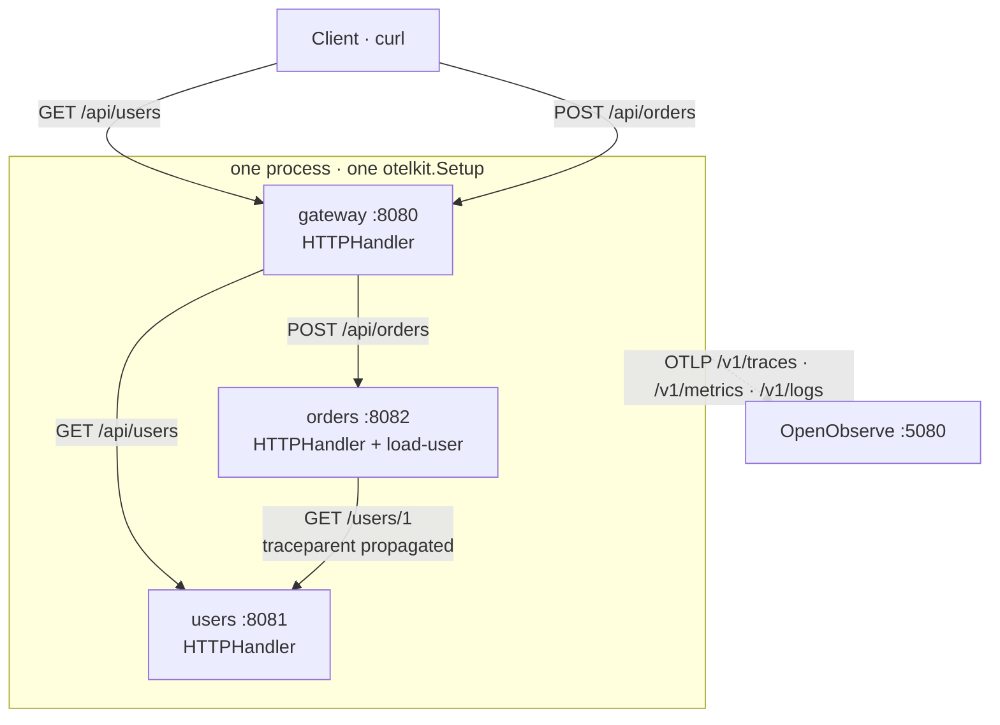
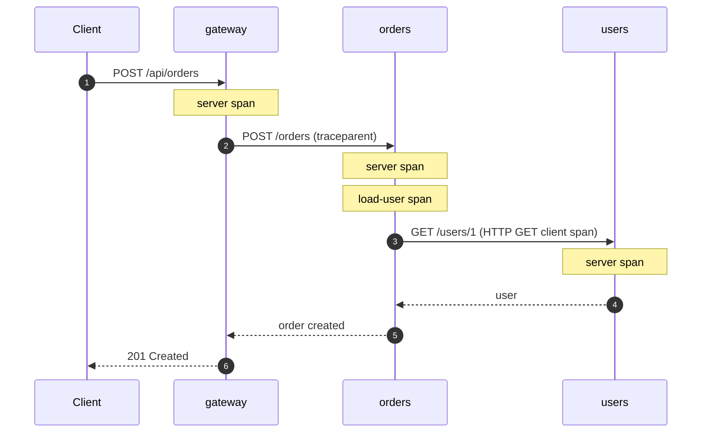

<div align="center">

# otelkit example

**Three simulated microservices, one binary, one trace.**

A gateway, an orders service and a users service run in separate goroutines on
separate ports. Every hop is instrumented with `otelkit`, so a single request
produces one connected trace.

[](https://github.com/semmidev/otelkit/actions/workflows/ci.yml)
[](../go.mod)
[](../LICENSE)

[Architecture](#architecture) · [Quick Start](#quick-start) · [Endpoints](#endpoints) · [Environment](#environment-variables) · [Traces](#see-the-trace) · [Library](../README.md)

</div>

---

## Table of Contents

- [Architecture](#architecture)
- [Quick Start](#quick-start)
  - [Docker Compose](#docker-compose)
  - [Local Go](#local-go)
- [Endpoints](#endpoints)
- [Environment Variables](#environment-variables)
- [Try It](#try-it)
- [See the Trace](#see-the-trace)
- [Logs](#logs)
- [How It Uses otelkit](#how-it-uses-otelkit)
- [Layout](#layout)
- [Troubleshooting](#troubleshooting)

## Architecture



All three services live in `main.go` and share one `otelkit.Setup` call, so every
span, metric and log is exported through the same OTLP pipeline. The calls
between services use `otelkit.HTTPClient()`, so the W3C `traceparent` header is
injected and extracted automatically. Each service also wraps its mux with
`logging.Middleware`, which emits one canonical log event per request.

Because the services share one process, they also share the demo resource, so
`service.name` is `otelkit-example` for every span. The instrumentation scope
(`gateway`, `orders`, `users`) and the span names identify which simulated
service handled each hop.

## Quick Start

### Docker Compose

Starts OpenObserve and the API, with OTLP pointed straight at OpenObserve:

```bash
docker compose up --build
```

| Service      | URL                     | Credentials                          |
| ------------ | ----------------------- | ------------------------------------ |
| API          | http://localhost:8080   | —                                    |
| OpenObserve  | http://localhost:5080   | `root@example.com` / `Complexpass#123` |

Stop the stack:

```bash
docker compose down      # keep the OpenObserve volume
docker compose down -v   # delete the volume too
```

### Local Go

Run everything on the host. With no backend:

```bash
OTEL_EXPORTER=none go run .
```

With a local OpenTelemetry Collector on `localhost:4318`:

```bash
OTEL_EXPORTER=otlp go run .
```

With OpenObserve on `localhost:5080`:

```bash
OPENOBSERVE_URL=http://localhost:5080 \
OPENOBSERVE_USER=root@example.com \
OPENOBSERVE_PASSWORD='Complexpass#123' \
OTEL_EXPORTER=none \
go run .
```

Copy `.env.example` to `.env` to keep these values around; `go run` does not
load it automatically, so export it with your shell or a tool such as
[`direnv`](https://direnv.net/).

## Endpoints

| Method | Path           | Service | Description                                                        |
| ------ | -------------- | ------- | ------------------------------------------------------------------ |
| `GET`  | `/healthz`     | gateway | Liveness probe. Filtered out of traces.                            |
| `GET`  | `/api/users`   | gateway | Proxies to `users` `GET /users`.                                   |
| `POST` | `/api/orders`  | gateway | Proxies to `orders` `POST /orders`, which validates the user first. |
| `POST` | `/api/logs`    | gateway | Ingests one JSON document into the configured OpenObserve stream.  |
| `GET`  | `/api/search`  | gateway | Runs SQL against OpenObserve; `?sql=` overrides the default query.  |
| `GET`  | `/users`       | users   | Lists demo users.                                                  |
| `GET`  | `/users/{id}`  | users   | Returns one demo user.                                             |
| `POST` | `/orders`      | orders  | Validates a user and creates a demo order.                         |

The `users` and `orders` ports are internal to the process. Only the gateway
port is published by Compose.

## Environment Variables

| Variable                          | Default                          | Description                                                        |
| --------------------------------- | -------------------------------- | ------------------------------------------------------------------ |
| `GATEWAY_ADDR`                    | `:8080`                          | Gateway listen address.                                            |
| `USERS_ADDR`                      | `:8081`                          | Users listen address.                                              |
| `ORDERS_ADDR`                     | `:8082`                          | Orders listen address.                                             |
| `USERS_URL`                       | `http://localhost:8081`          | Base URL the gateway and orders use to reach users.                |
| `ORDERS_URL`                      | `http://localhost:8082`          | Base URL the gateway uses to reach orders.                         |
| `OTEL_SERVICE_NAME`               | `otelkit-example`                | Resource `service.name`.                                           |
| `DEPLOYMENT_ENVIRONMENT`          | `development`                    | Resource `deployment.environment.name`.                            |
| `OTEL_EXPORTER`                   | `otlp`                           | `otlp`, `stdout` or `none`.                                        |
| `OTEL_EXPORTER_OTLP_ENDPOINT`     | —                                | Base OTLP URL. otelkit appends `/v1/{traces,metrics,logs}`.        |
| `OTEL_EXPORTER_OTLP_HEADERS`      | —                                | OTLP headers, read by the OpenTelemetry SDK.                       |
| `OPENOBSERVE_URL`                 | —                                | Enables `POST /api/logs` and `GET /api/search` when set.           |
| `OPENOBSERVE_ORG`                 | `default`                        | OpenObserve organization.                                          |
| `OPENOBSERVE_USER`                | —                                | Basic auth username.                                               |
| `OPENOBSERVE_PASSWORD`            | —                                | Basic auth password.                                               |
| `OPENOBSERVE_TOKEN`               | —                                | Bearer token, instead of basic auth.                               |
| `OPENOBSERVE_STREAM`              | `example_logs`                   | Stream used by ingest and the default search query.                |

`OTEL_EXPORTER_OTLP_HEADERS` is consumed by the OpenTelemetry SDK when
`otelkit.Config.Headers` is empty, which is how Compose authenticates against
OpenObserve without hardcoding credentials in Go.

## Try It

```bash
# Gateway -> users
curl http://localhost:8080/api/users

# Gateway -> orders -> users (one connected trace)
curl -X POST http://localhost:8080/api/orders

# OpenObserve client: ingest and search
curl -X POST http://localhost:8080/api/logs \
  -H 'Content-Type: application/json' \
  -d '{"level":"info","message":"hello from the example"}'

curl 'http://localhost:8080/api/search?sql=SELECT%20*%20FROM%20example_logs%20LIMIT%205'
```

## See the Trace

1. Open http://localhost:5080 and sign in with `root@example.com` /
   `Complexpass#123`.
2. Go to **Traces** and filter on service `otelkit-example`.
3. Open the trace created by `POST /api/orders`.

The waterfall contains six spans across three services:



| Span                    | Kind   | Service scope |
| ----------------------- | ------ | ------------- |
| `POST /api/orders`      | server | gateway       |
| `HTTP POST`             | client | gateway       |
| `POST /orders`          | server | orders        |
| `load-user`             | internal | orders      |
| `HTTP GET`              | client | orders        |
| `GET /users/{id}`       | server | users         |

Logs are emitted as one canonical event per service hop; see [Logs](#logs).
Metrics `http.requests`, `orders.created` and `orders.latency` appear under
**Metrics**.

## Logs

`POST /api/orders` produces three canonical events, one from each service hop.
They share the same `trace_id` and have different `span_id`, so filtering by
`trace_id` in OpenObserve reconstructs the whole request.

```json
{
  "time": "2026-11-07T10:23:45.612Z",
  "level": "INFO",
  "msg": "order_created",
  "service": "orders",
  "http.method": "POST",
  "http.path": "/orders",
  "user_id": 1,
  "order_id": "ord-1",
  "latency_ms": 16,
  "upstream": "users",
  "http.route": "POST /orders",
  "http.status": 201,
  "http.bytes": 83,
  "duration_ms": 16.42,
  "outcome": "success",
  "trace_id": "...",
  "span_id": "..."
}
```

The middleware adds the request fields automatically. Handlers only add
business context with `logging.Add`, `logging.Error` and `logging.SetMessage`.
Errors, 5xx responses and slow requests are always kept; healthy traffic can be
sampled with `logging.Config.HealthySampleRate`.

In OpenObserve the OTel log body is stored as `body`, and attribute names are
normalized with underscores (`http_status`, `http_route`, `trace_id`), so query
those columns in the **Logs** view.

## How It Uses otelkit

```go
// One bootstrap for the whole demo process.
telemetry, err := otelkit.Setup(ctx, otelkit.Config{
	ServiceName: "otelkit-example",
	Exporter:    otelkit.ExporterOTLP,
	Endpoint:    os.Getenv("OTEL_EXPORTER_OTLP_ENDPOINT"),
})
defer telemetry.Shutdown(ctx)

// Every service gets server spans, metrics and one canonical log event.
mux := http.NewServeMux()
// ... routes ...
handler := otelkit.HTTPHandler(
	logging.Middleware(mux, logging.Config{
		Fields:    []slog.Attr{slog.String("service", "orders")},
		SkipPaths: []string{"/healthz"},
	}),
	"orders",
)

// Every inter-service call propagates trace context.
client := otelkit.HTTPClient()
resp, err := client.Do(req.WithContext(ctx))

// Custom spans nest inside the instrumented ones.
ctx, span := otel.Tracer("orders").Start(ctx, "load-user")
defer span.End()

// Enrich the request event as the handler learns more.
logging.Add(ctx, "user_id", u.ID, "order_id", "ord-1", "latency_ms", latencyMs)
logging.SetMessage(ctx, "order_created")

// On failure, record the error on the same event.
logging.SetMessage(ctx, "order_failed")
logging.Error(ctx, err)

// Lifecycle logs still use slog directly.
slog.Info("listening", "service", "orders", "addr", ":8082")
```

The OpenObserve-specific calls use `github.com/semmidev/otelkit/openobserve`
for SQL search and JSON ingestion, since OTLP only covers telemetry signals.

## Layout

```text
example/
├── main.go          # all three services and their routes
├── compose.yaml     # OpenObserve + API
├── Dockerfile       # multi-stage build of the example
└── .env.example     # local configuration template
```

## Troubleshooting

- **`address already in use`** — change `GATEWAY_ADDR`, `USERS_ADDR` or
  `ORDERS_ADDR`, and update `USERS_URL` / `ORDERS_URL` to match.
- **No traces in OpenObserve** — confirm `OTEL_EXPORTER=otlp`,
  `OTEL_EXPORTER_OTLP_ENDPOINT=http://openobserve:5080/api/default` (Compose)
  or `http://localhost:5080/api/default` (host), and that the authorization
  header matches the OpenObserve credentials.
- **`OPENOBSERVE_URL is not configured`** — only the log ingest and search
  endpoints need it; tracing and metrics still work without it.
- **Changed OpenObserve credentials in Compose** — also update
  `OTEL_EXPORTER_OTLP_HEADERS` in `compose.yaml`; it is the base64 of
  `user:password`.
